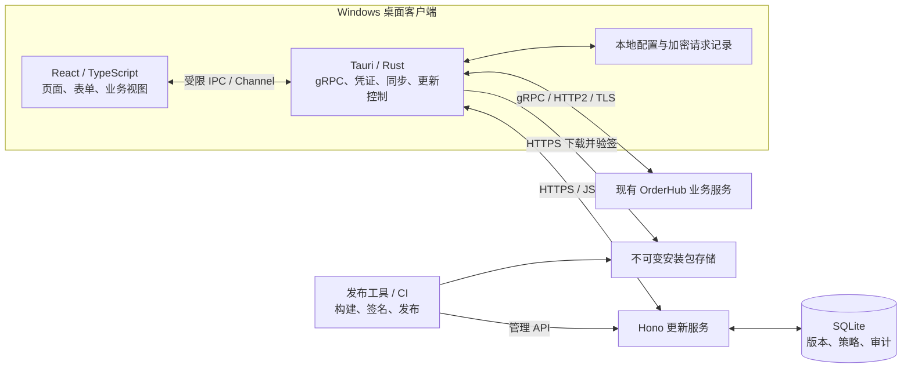

# OrderHub Desktop MVP 总体方案

日期：2026-10-19。状态：设计稿，尚未实施或联调。首轮平台：Windows x64（已确认）。

采用 **TypeScript + React + Tauri 2 客户端，TypeScript + Hono + SQLite 更新服务**。客户端通过 Tauri 的 Rust 原生适配层直连现有 OrderHub gRPC 服务；更新使用独立 HTTPS 服务和签名完整安装包。MVP 验证两个闭环：**业务状态同步、报单和撤单；发布新版本、下载验签、安装重启和恢复业务连接。**

## 1. 范围与关键决策

| 项目 | MVP 决策 |
| --- | --- |
| 平台与安装 | Windows x64，NSIS 安装包，优先按用户安装；固定应用标识及安装范围 |
| 客户端 | React + TypeScript + Vite；Tauri 2 提供原生网络、安全存储和更新能力 |
| 业务通信 | Rust `tonic/prost` 使用现有 proto，gRPC / HTTP/2 / TLS |
| 更新服务 | TypeScript + Hono，运行于受支持的 Node.js LTS；SQLite 保存元数据 |
| 更新方式 | 完整安装包，后台检查及下载，用户确认后安装；支持 stable/beta、灰度、暂停、最低版本策略 |
| 业务范围 | 连接与凭证配置、可见账户/持仓、活动订单、受限报单、撤单、请求结果追踪 |
| 首轮部署 | 一台更新服务器、一个 Hono 实例、本地持久卷；业务服务独立部署 |
| 暂缓 | 差分更新、运行中替换前端代码、无人值守自动回退、多区域高可用、完整发布管理后台 |

界面和交互仍以 TypeScript 编写，但 Tauri 客户端需要少量 Rust：负责原生 gRPC、凭证、连接恢复及安装前保护。MVP 不引入 Node sidecar，也不增加业务 BFF。浏览器 gRPC-Web 通常需要相应服务端或代理支持；本方案选择原生连接以适配已有接口。[gRPC-Web 官方示例](https://grpc.io/docs/platforms/web/basics/)

## 2. 总体结构与职责



业务服务是订单、持仓及业务权限的权威来源。更新服务管理软件版本，不代理交易，也不保存业务 Token 或订单数据。安装包存于文件存储，SQLite 只保存地址、签名和发布元数据。

业务连接、更新连接分别维护状态和重试任务。更新服务短暂故障不会主动切断业务连接；后台下载也不能阻塞 gRPC 消费及撤单操作。

## 3. 客户端与前端设计

### 3.1 页面与模块

| 页面/模块 | 内容 |
| --- | --- |
| 连接设置 | 从当前目录 config 读取服务地址、TLS 和 Token 配置，查看连接状态；配置更新后显式重新连接 |
| 业务工作台 | 可见账户与持仓、活动订单、服务 readiness、writable、stale 和同步状态 |
| 报单面板 | 策略、合约、买卖、数量、限价；依据合约步进校验，提交前确认 |
| 订单详情 | 当前订单状态、撤单、当前会话事件、按订单 ID 查询终态 |
| 请求记录 | 区分等待受理、已受理、业务拒绝、结果未知；支持查询未知结果 |
| 查询入口与预留页 | 已有能力接入 GetState；历史订单列表、历史成交、全账户资金/持仓和行情查询预留入口及适配层 |
| 更新与关于 | 当前版本/通道、新版本说明、下载进度、稍后安装、立即安装、失败重试 |
| 诊断 | 脱敏连接信息和错误码，导出用户确认后的诊断文件 |

Snapshot 只返回活动订单，现有接口不能枚举完整历史订单/成交。MVP 的历史区域仅显示本机已知订单及本次会话事件，明确覆盖范围。没有行情接口时不展示虚构实时行情；下单价格由用户输入。账户/持仓视图只展示当前身份可见的投影，不能标成账户全局资产。

### 3.2 分层与状态

- **UI 层**：页面、表单与交互；组件不直接持有 gRPC 客户端或安装器。
- **TypeScript 业务层**：精确数值校验、订单视图 reducer、请求状态与错误展示。通过单一数据入口应用快照和有序事件，避免多处缓存互相覆盖。
- **原生适配层**：gRPC 连接、认证头、分页/重连编排、受限本地存储、更新检查与安装互斥。价格和 ID 不在适配时转换语义。
- **IPC 契约**：有限命令，例如连接、同步、报单、撤单、查询请求、检查更新、下载、安装；错误统一带类别、错误码及关联 ID。

流事件和更新进度使用 Tauri Channel；窗口关闭、切换环境或退出凭证时取消旧订阅。为会话分配 generation，拒绝旧连接迟到的事件。Rust 到前端使用有界队列，业务事件不能为了刷新帧率被丢弃；只合并界面渲染。队列无法及时消费时进入重同步。[Tauri Channel 文档](https://v2.tauri.app/develop/calling-frontend/)

客户端连接状态为：`未连接 → 认证/连接中 → 同步中 → 已同步`；异常转为`重连中 / 状态陈旧 / 需重新认证`。只有完成同步、状态不陈旧且服务允许写入时开放新报单；界面校验和按钮状态不能替代服务端校验。

### 3.3 查询能力与前端预留

后台已有统一查询 RPC `GetState`，前端按查询类型接入；缺失的查询能力先保留页面入口、查询条件区域和数据适配边界，不要求 MVP 新增业务后端接口。

| 查询需求 | 当前接口能力 | 前端安排 |
| --- | --- | --- |
| 当前活动订单、策略持仓、策略资金占用、合约信息及运行状态 | `GetState(Snapshot)`，按授权范围返回 | MVP 接入，查询/刷新及当前快照内筛选 |
| 已知订单 ID 的详情与状态 | `GetState(OrderLookup)`，可返回活动或终态订单 | MVP 接入；不能等同于可枚举全部历史订单 |
| 报单/撤单请求的原始受理或拒绝结果 | `GetState(RequestLookup)` | MVP 接入，独立于订单最终状态展示 |
| 按时间、合约、状态分页检索历史订单 | 当前 proto 未提供此类列表查询 | 预留历史订单页面、筛选区和分页适配位置 |
| 历史成交明细检索 | 当前 proto 未提供独立历史成交查询 | 预留成交查询页面；本次会话事件不能冒充完整历史 |
| 全账户资金余额与全账户持仓 | 当前仅有授权策略视图，不提供全账户查询 | 预留账户查询区域，与已接入的策略视图区分 |
| 行情查询 | 当前服务未提供报价查询，Snapshot 也不返回 quotes | 预留行情区域和数据源适配位置 |

预留页明确显示“后台暂未提供该查询接口”，禁用真实查询和导出操作，不显示“查询成功、暂无数据”或伪造结果。筛选条件和分页字段仅作为前端草案，最终以新增接口契约为准。通过统一查询适配层报告能力是否可用；后续接入时替换适配实现，保持页面结构稳定。已有快照内筛选应标明“当前已加载数据”，不能当作服务端历史检索。

此处为设计预留，尚未创建前端页面或代码。能力依据：[GetState 查询说明](<D:/projects/codexworkspace/OrderHub/grpc-integration/OrderHub-gRPC接口文档.md:159>)。

### 3.4 当前目录下的 config 配置约定

按用户指定，MVP 的服务端地址、TLS 和 Token 统一使用当前目录下的 `config`。当前开发/联调配置根目录为 `D:\projects\codexworkspace\OrderHub\OrderHub desktop\config`，已存在以下文件，直接沿用，不生成或覆盖真实凭证：

| 文件 | 用途 |
| --- | --- |
| `config/client.toml` | 主配置；`connection.address` 为业务服务地址，`tls_domain` 为 TLS 服务身份名称，`ca_file`、`token_file` 引用下列文件 |
| `config/tls/ca.pem` | 业务服务 CA 公钥证书，用于验证证书链 |
| `config/tls/client-token.txt` | 部署方提供的业务 Bearer Token，由原生层读取，不在文档、界面或日志中回显 |
| `config/tls/README.md` | TLS 文件使用说明 |

`ca_file="tls/ca.pem"`、`token_file="tls/client-token.txt"` 均相对于 **client.toml 所在的 config 目录**解析，不相对于前端资源目录或临时工作目录。配置根目录在启动时确定，Rust 负责读取并验证格式、路径和文件可读性；缺失或无效时停留在未连接状态，明确报告配置错误。变更地址或 Token 后结束旧会话、重新同步，旧未知请求仍按原授权上下文核对。

当前文件只提供业务连接配置，尚未配置更新服务地址。后续更新服务地址也放在 `config/client.toml` 的独立更新配置区，业务与更新 Token 分开管理，不复用业务 Token。更新包验签公钥继续随客户端内置；它不是 TLS CA，发布签名私钥不进入客户端 config。

本 MVP 按现有文件直接读取 Token，不要求先迁移到系统凭据库。config 中的真实地址、Token 和部署证书不写入源码、日志、诊断导出或通用安装包；升级时保留用户的 config，不以示例覆盖。正式安装后的配置根目录由启动入口显式确定；本次开发和联调固定使用上述当前目录，不改用 AppData 或其他隐式位置。

### 3.5 前端图片资源（已生成，可供开发使用）

使用 imagegen 技能的内置 image_gen 模式生成第一组无文字 PNG，已保存在当前项目的 `assets/images/orderhub-v1`。材质统一为石墨金属、雾面玻璃和低饱和青色细节；用于连接、更新及查询辅助页面，不铺在交易表格或报单表单后面。

| 资源 | 实际尺寸 / 背景 | 使用位置 | 开发约束 |
| --- | --- | --- | --- |
| [connection-hero.png](<D:/projects/codexworkspace/OrderHub/OrderHub desktop/assets/images/orderhub-v1/connection-hero.png>) | 1536 × 1024 / 深色不透明 | 连接配置页、关于页的独立装饰面板 | 建议宽 420–720px，配置与状态放在图片外；不得裁切后冒充应用图标 |
| [update-package.png](<D:/projects/codexworkspace/OrderHub/OrderHub desktop/assets/images/orderhub-v1/update-package.png>) | 1254 × 1254 / 透明 | 更新说明、待下载或待安装区域 | 建议宽 200–280px；进度、验签和安装结果由真实组件表达 |
| [query-placeholder.png](<D:/projects/codexworkspace/OrderHub/OrderHub desktop/assets/images/orderhub-v1/query-placeholder.png>) | 1254 × 1254 / 透明 | 尚未提供接口的历史查询、行情等预留页 | 建议宽 180–240px；配合“后台暂未提供该查询接口”，不能表示“查询结果为零” |
| [connection-recovery-v2.png](<D:/projects/codexworkspace/OrderHub/OrderHub desktop/assets/images/orderhub-v1/connection-recovery-v2.png>) | 1254 × 1254 / 透明 | 断线、重连、重新同步辅助区域 | 建议宽 280–360px；不遮挡真实错误原因及重试操作，不表示已恢复成功 |

三张透明插画保持比例并使用 `object-fit: contain`。图片无文字，业务标题、状态、按钮由 React 实现；装饰图片设置空 alt，状态文字保持可读和可访问。所有图片随安装包本地交付，不依赖外部图片 URL，也不包含 config 中的服务地址或凭证。建议按页面加载；原 PNG 保留，后续压缩派生资源须保留透明通道并重新检查效果。

开发配套文件：[素材说明与图片预览](<D:/projects/codexworkspace/OrderHub/OrderHub desktop/assets/images/orderhub-v1/README.md>)、[本地深浅背景预览页](<D:/projects/codexworkspace/OrderHub/OrderHub desktop/assets/images/orderhub-v1/preview.html>)、[可读取的素材清单](<D:/projects/codexworkspace/OrderHub/OrderHub desktop/assets/images/orderhub-v1/asset-manifest.json>)、[完整生成与修订提示词](<D:/projects/codexworkspace/OrderHub/OrderHub desktop/assets/images/orderhub-v1/generation-record.json>)。开发使用 manifest 中的四张最终图，drafts 内初稿不进入应用。

连接页主视觉预览：


当前已目检图像、检查实际尺寸和透明通道。预览页已提供，但浏览器 URL 安全策略阻止本地 file 页面，深浅背景及实际 CSS 尺寸的浏览器显示效果尚未验证；后续开发需补查。上述交付为图片资源及接入约定，尚未实现客户端页面。

## 4. 通信协议与数据约定

| 链路 | 协议与契约 | 主要约束 |
| --- | --- | --- |
| React ↔ Tauri | 类型化 IPC DTO；流使用 Channel | 明确命令白名单；原生层重复校验；不开放任意 URL 请求、Shell 或文件读写 |
| Tauri ↔ OrderHub | 现有 `orderhub.v1` proto，gRPC / HTTP2 / TLS | 每个 RPC 携带 `authorization: Bearer ...`，校验 CA 与服务名称 |
| Tauri ↔ 更新服务 | HTTPS / JSON，`/v1` 版本化接口 | 原生层固定服务地址、平台与通道枚举；运行时校验响应 |
| 发布工具 ↔ 更新服务 | HTTPS / JSON + 受限管理 API | 发布凭证与客户端业务凭证分离；发布操作审计 |
| Tauri ↔ 包存储 | HTTPS 二进制下载 | 可信来源列表、下载大小限制、完整包签名校验 |

所有 64 位游标、版本序号、纳秒时间戳，以及金额、价格、数量，在 Rust/TypeScript 边界均用字符串。需要比较游标时使用精确整数；金额计算使用十进制定点/高精度实现，禁止 JavaScript `Number` 浮点计算。UI 展示格式不改变提交的精确值。

`page_token` 和 `resume_token` 视为不透明字符串，禁止自行构造、解析或写日志。事件类型、业务状态和 reason 按可扩展字符串处理：未知类型保留诊断信息并采取保守展示；影响正确性的未知事件触发重同步或关闭新报单，不能静默忽略后继续交易。

冻结一份 proto 及来源 revision/hash，生成 Rust 客户端；IPC DTO 的 TypeScript 类型与 Rust 序列化规则保持一致。更新 HTTP API 用共享 schema 定义并生成简版 OpenAPI。三类契约分别版本化，不把桌面版本号当成业务协议版本号。

## 5. 现有业务接口接入

### 5.1 能力与业务状态

| RPC | 客户端用途 | 必须正确理解的结果 |
| --- | --- | --- |
| `GetState` | Snapshot、OrderLookup、RequestLookup | 三种查询是 oneof；RequestLookup 返回原始受理结果，不是订单终态 |
| `WatchEvents` | 有序接收业务事件、视图和进度 | 事件可重复，序号可跳跃；Progress 不是成交事件 |
| `SubmitOrder` | 新建业务意图并提交 | `ADMITTED` 仅表示接纳，不代表交易所接受、成交或刷盘 |
| `CancelOrder` | 提交独立撤单意图 | `CANCEL_INTENT_ACCEPTED` 不等于撤成；等待订单最终状态 |

当前资料描述的落地能力是 `GOX-001 / AAPL.GOX / USD`，限价、整股、`DAY`，卖出受已确认持仓约束，`post_only`、`reduce_only` 均关闭。MVP 仅暴露这些受支持选项；步进以 Snapshot 合约信息为准。

**文档差异必须保留：** proto 的 time-in-force 注释列举 `GTC | IOC | FOK`，业务文档和请求示例要求当前使用 `DAY`。MVP 按当前业务文档设计，并将 `DAY` 成功、其他类型拒绝纳入目标服务联调。不能单凭注释生成下拉框。[接口文档](<D:/projects/codexworkspace/OrderHub/grpc-integration/OrderHub-gRPC接口文档.md>)、[协议定义](<D:/projects/codexworkspace/OrderHub/grpc-integration/proto/orderhub.proto>)

### 5.2 快照、事件与恢复

1. 连接后调用 Snapshot，保存该快照的 `journal_epoch + state_cursor + resume_token`；按 `next_page_token` 取完全部活动订单页。
2. 只有活动订单分页，账户、持仓、输入和合约信息不能每页重复累加。快照租约为 60 秒，分页失败或过期则整份重取，不拼接两个基线。
3. 完整快照一次性建立界面基线，再用配套的 `after=state_cursor`、epoch、resume_token 启动 Watch。
4. 事件按收到顺序应用，再推进“已应用游标 + 配套 token”。普通事件用外层 event_id 或 epoch/seq 去重；Progress 允许重复 seq、空 event_id，必须在此前业务事件处理完后更新检查点。
5. 权限过滤会造成 seq 跳号，不能据此判断丢包。单次 OrderLookup 也不能替代整个业务视图的同步水位；RequestLookup 不提供可用于建立 Watch 基线的 token。
6. 普通断线在同一内存基线下从最后已应用检查点续传；token 过期、`RESYNC_REQUIRED`、`SLOW_CONSUMER`、epoch/权限变化或基线失效时重新 Snapshot。

MVP **不持久化完整业务视图**：检查点与视图在同一个串行消费流程中提交，当前进程内恢复；客户端重启、窗口状态丢失或升级后统一重新 Snapshot。禁止只持久化游标却丢失其对应视图，再从该游标继续。

运行状态单独更新。`state_cursor` 表示状态水位，`durable_cursor` 才表示成功刷盘的连续前缀；默认异步持久化时，受理响应可能早于刷盘。界面不将“已受理”标成“已持久化”。

### 5.3 报单、撤单与未知结果

报单前生成 request_id，并在本地可靠保存请求方法、原始参数、提交 epoch、环境、凭证引用/指纹及请求状态，保存成功后才发送。服务端按 `(journal_epoch, 服务端映射的 submitter_id, RPC方法, request_id)` 去重；客户端不发送已被服务端忽略的兼容 `submitter_id` 字段。凭证指纹仅用于区分本地授权上下文，不作为服务端身份的证明。

超时、断网、取消等待或进程恢复后，先在原授权上下文中使用原 epoch、方法和 request_id 做 RequestLookup。`REQUEST_NOT_FOUND` 仅说明查询时不可见，不能证明请求没执行。原键重试必须同时满足原环境、RPC 方法、epoch、参数和服务端映射的 submitter_id 均未变化，且仍在服务端幂等保留范围内；绝不换新 ID 自动补单。

当前接口没有独立的身份确认接口，因此 **MVP 只自动查询结果，不自动重发写请求**。用户确认重试前仍要满足上述约束；无法确认就继续保留未知状态。切换凭证、权限或环境时暂停旧请求的恢复，使用原授权上下文核对或人工处理；epoch 改变后重新同步并核对，旧意图保留为待人工确认。

撤单使用自己的 request_id；撤单过程中仍可能成交。被业务拒绝的原请求也有幂等结果，条件改善后要由用户明确发起新意图。未确认结果的请求记录在安装前必须保留，升级不能清空。

| 故障类别 | 处理原则 |
| --- | --- |
| Token/权限问题 | 当前业务服务可能返回 `PERMISSION_DENIED`；停止相关写入并提示重新配置，不盲目循环认证 |
| 参数/幂等冲突 | 展示原始 reason，保留原请求；不自动修改参数重发 |
| 网络/超时/服务不可用 | 只读调用指数退避并加随机抖动；写入按“结果未知”查询，不套通用自动重试 |
| 限流/队列满 | 限制客户端并发并退避；不把队列错误解释成交易所拒单 |
| HALTED/STOPPED/状态陈旧 | 展示服务状态，关闭新报单；查询和撤单是否可用仍由业务服务决定 |

单次查询设置超时，Watch 使用独立长连接与停滞检测，不套用短请求超时。MVP 每个业务会话只维持一条 Watch；16 KiB 请求上限、1000 条查询/分页上限等保持在协议适配层。具体超时和退避参数通过联调确定。

## 6. 客户端更新模式

Tauri updater 负责包下载、签名校验和安装；Hono 决定向谁提供哪个版本；React 提供交互。签名完整包是本次实现基础。[Tauri Updater](https://v2.tauri.app/plugin/updater/)

| 模式 | MVP 做法 |
| --- | --- |
| 手动检查 | “关于/更新”入口随时检查 |
| 自动检查 | 启动后后台检查，运行中按间隔加随机抖动；不阻塞首屏 |
| 提示更新 | 显示版本、说明、下载大小和是否必须更新 |
| 后台下载 | 用户设置允许后自动下载，下载完成等待安装；失败可重试 |
| 安装时机 | 用户确认立即安装，或本次会话正常退出前安装；交易进行时不强制重启 |
| 灰度发布 | 按稳定 installation_id 分桶，支持测试通道和逐步扩大比例 |
| 强制更新 | 使用最低支持版本及生效时间限制新报单，保留查询/诊断及服务允许的撤单 |
| 暂停发布 | 停止下发并在安装前重新确认；已安装版本不会因此自动卸载 |
| 回滚处置 | 暂停问题版本，将已知可用代码重新构建为更高修复版本发布 |
| 离线更新 | 提供可信签名安装包人工覆盖安装；首轮可作为故障恢复通道 |

差分包、跨进程断点续传、无人值守静默安装和失败后自动切换旧二进制留待后续。MVP 不承诺崩溃/重启后保留已下载内容；允许重新下载。前端资源随安装包发布，不远程加载可执行 JS 完成“热更新”。

### 6.1 更新服务接口

以下为本方案新增的 HTTP 契约，与业务 gRPC 无关：

| 接口 | 用途 |
| --- | --- |
| `GET /v1/update-policy/{channel}/{target}/{arch}/{currentVersion}` | 返回当前版本是否允许继续使用、最低版本、生效时间、策略 revision、选中 release_id 及策略有效期 |
| `GET /v1/updates/{channel}/{target}/{arch}/{currentVersion}?release_id=...` | 供 updater 调用，返回绑定该发布记录的标准更新响应 |
| `GET /v1/releases/{releaseId}/eligibility` | 安装前重新确认该客户端仍可安装此版本；暂停/撤回则取消安装 |
| `POST /v1/update-events` | 上报检查、下载、启动确认和失败阶段；短记录、限流、幂等，不含业务信息 |
| `POST /v1/admin/releases` | 注册已构建的版本、包位置、签名、大小和 SHA-256，初始为 draft |
| `POST /v1/admin/releases/{id}/publish`、`/pause`、`/revoke` | 发布、暂停、撤回；校验并发版本并记录审计 |
| `PUT /v1/admin/channels/{channel}/policy` | 更新最低版本及灰度策略，必须校验存在可用的兼容升级路径 |
| `GET /healthz`、`GET /readyz` | 更新服务存活和数据库/包存储可用性探测 |

更新无候选版本时返回 `204`；存在更新时返回 `200` 和如下结构。认证失败、参数错误、服务故障使用对应 4xx/5xx，不能伪装成“没有更新”。

```json
{
  "version": "0.2.0",
  "pub_date": "2026-10-19T08:00:00Z",
  "url": "https://updates.example.com/artifacts/0.2.0/windows-x86_64/setup.exe",
  "signature": "<该安装包 .sig 文件的完整内容>",
  "notes": "修复连接恢复，并改进请求状态展示"
}
```

以上是示意值。`signature` 是签名内容，不是签名文件地址；最低版本/灰度等属于自定义 policy，插件不会自动执行这些产品规则。通道由原生层选择并写入地址，不能假定 Tauri 支持 `{{channel}}` 模板变量。标准响应格式依据 [Tauri 动态更新服务协议](https://v2.tauri.app/plugin/updater/#dynamic-update-server)。

检查、取包信息及安装资格请求统一携带 `X-Installation-ID` 和安装类型（MVP 为 NSIS）；三者都提供 channel、target、arch、currentVersion，未在路径中的字段作为查询参数，版本和平台取自原生层。策略和更新响应使用 `Cache-Control: no-store`，安装包使用不可变地址并可长期缓存。

先取得 policy，再把选中的 `release_id + policy_revision` 固定给本次 updater 检查及安装资格复核。服务端校验 revision，按相同上下文重算资格并匹配 release_id；revision 已变化则返回 `409 POLICY_CHANGED`，客户端重新取得策略。旧下载包只有仍被新策略选择且验签通过时才可继续使用。这里的 revision 用于一致性控制，不是认证凭证；只修改 release_id 不能绕过服务端选择规则。

低于最低版本的客户端仍可访问全部更新接口，policy 必须返回兼容的强制升级候选，updates 不得因其版本过旧而拒绝或返回 `204`。强制候选绕过灰度，仍校验平台、架构及兼容性。发布最低版本策略时无可用升级路径则拒绝发布；运行期间因包损坏或撤回导致无候选时，返回明确的恢复错误和人工安装指引，不伪装为“已经最新”。

### 6.2 灰度与最低版本规则

选包顺序为：应用及环境 → 平台/架构/安装类型 → 通道 → 已发布且兼容 → 最低版本要求 → 灰度资格 → 最高合适 SemVer。禁止字符串比较版本号，禁止 stable 自动跳入 beta。MVP 切换 beta 后不直接降级回较低 stable；等待 stable 追平或使用受控人工恢复。

灰度使用随机生成并持久保存的 installation_id，按 release_id 与 installation_id 稳定哈希到固定桶；调整比例不应每次重新随机抽签。每个通道策略指定当前推广版本和比例，其余仍受支持的已发布版本可作为兜底。installation_id 不是认证凭证，也不是硬件指纹，分桶不能用于保护私有版本的访问权限。低于最低支持版本的客户端绕过灰度，但必须能取得已验证兼容的升级包；否则禁止发布该强制策略。

最低版本策略在**原生报单命令入口**与 UI 同时执行。更新服务不可达时使用上次有效策略；首次无策略或已过有效期时进入受限模式，保留查询、诊断及业务服务允许的撤单，不直接退出程序。短暂检查失败不改变尚有效的授权状态。

这是配合客户端执行的产品策略。现有业务协议没有可信客户端版本准入机制，不能声称它能阻止被修改的旧客户端交易；若后续需要服务端强制淘汰版本，需要另行扩展业务网关准入。仅上报版本请求头也不是可信证明。

### 6.3 安装状态与失败处理

流程：`检查 → 可更新 → 下载 → 验签 → 待安装 → 安装前检查 → 安装 → 新版本启动确认`。

安装前在原生层取得互斥锁并停止接受新写入，处理在途调用；仍结果未知的请求先持久保存并明确提示。已存在的活动订单可能在客户端关闭后继续运行，不能等同于“没有在途 RPC 就没有风险”。用户确认维护时机后，保存设置和请求记录、关闭流连接，再启动安装器。退出更新流程不自动撤销全部订单。

Windows updater 启动安装器后会退出应用，因此“调用安装成功”不等于“新版本可用”。新版本写入本地启动确认，成功建立界面和本地存储后再上报；业务服务不可达单独记录，不视为安装失败。[Updater 原生 API](https://docs.rs/tauri-plugin-updater/latest/tauri_plugin_updater/struct.Update.html)

验签失败、包不可下载或磁盘不足时停止安装并允许继续使用符合策略的旧版本。安装前资格复核失败或服务不可达时暂缓安装；已经通过复核并进入安装器的任务无法靠后续撤回即时取消。安装中失败或新版本无法启动时使用保留的可信安装包人工修复；MVP 不承诺安装器原子回退。更新回执只是观测信息，未收到回执可能是未启动或离线，不能据此自动回滚。

## 7. Hono 更新服务与 SQLite

服务拆为路由/鉴权、策略选择、发布管理、文件元数据校验、审计及观测六个模块。采用 Node.js 上的 Hono adapter；SQLite 驱动在实施时锁定支持的版本，首轮使用简单 SQL 迁移即可，无须为 MVP 引入复杂服务拆分。[Hono Node.js 部署方式](https://hono.dev/docs/getting-started/nodejs)

| 数据实体 | 保存内容与约束 |
| --- | --- |
| `releases` | release_id、应用、SemVer、通道、说明、状态、发布时间；已发布版本不可原地替换 |
| `artifacts` | release_id、target、arch、安装类型、对象位置、大小、SHA-256、签名；发布前必须齐全 |
| `channel_policies` | 当前推广 release_id、最低版本、生效时间、灰度比例、策略 revision、有效期规则 |
| `update_events` | installation_id、版本、阶段、错误类别、时间、幂等事件 ID；设留存上限 |
| `audit_logs` | 发布者、动作、对象、策略前后摘要、时间和关联 ID；应用层禁止普通操作修改 |

发布过程：构建/签名 → 上传临时包 → 校验大小、摘要和签名 → 固定不可变路径 → 注册 draft → 试装通过 → 事务发布。数据库发布提交前不对客户端可见；文件与 SQLite 不共用事务，故必须先保证包可读再切换发布状态。相同版本和目标的内容不能被重复上传覆盖。

SQLite 使用本机持久卷、WAL、外键、短写事务、busy timeout 和版本化迁移。首轮单实例，业务流量不进入此库；大量下载由反向代理/文件服务承担。WAL 允许读写并行但同一时刻只有一个写者，不使用共享网络盘让多个服务器直接写同一文件。[SQLite WAL](https://sqlite.org/wal.html)

备份包含数据库一致性备份及其引用的安装包；不能只复制运行中的主 `.db` 而遗漏 WAL 内容。定期做一次恢复演练，保留已发布及应急修复包。[SQLite 在线备份](https://sqlite.org/backup.html)

## 8. 安全、认证与加密

| 对象 | MVP 措施 |
| --- | --- |
| 传输 | 业务使用文档规定的 TLS 1.2/1.3；更新与下载使用 HTTPS；验证证书链和名称，不提供关闭验证的正式开关 |
| 业务身份 | 部署方提供 Bearer Token；每次 RPC 都带认证；权限和真实 submitter 由服务端映射 |
| 客户端凭证 | 按指定从 `config/tls/client-token.txt` 读取，文件权限限运行用户及必要管理员；Rust 按需使用，不返回 UI，不写日志 |
| 本地请求记录 | 原生层保存，含敏感业务参数的内容使用 DPAPI 保护，原子写入；文件 ACL 限当前用户 |
| 更新访问 | MVP 置于受控内网/VPN，客户端只读检查/下载；若扩展到公网私有分发，再接独立更新访问凭证 |
| 发布权限 | 单独高熵发布令牌或 CI 身份，从安全配置注入，支持撤销；客户端不包含发布密钥 |
| 安装包真实性 | Tauri updater 原生签名，公钥随客户端内置，私钥仅在受控构建/签名环境 |
| Windows 发行身份 | 对外分发增加 Authenticode；与 updater 签名分别管理，不互相替代 |
| WebView/IPC | 打包本地前端、严格 CSP、最小 capability、受限自定义命令；发布说明按纯文本或安全 Markdown 渲染 |
| 服务端数据 | SQLite/安装包卷使用磁盘加密和 ACL；数据库不保存业务凭证、签名私钥；参数化 SQL、请求校验、限流 |
| 日志 | 不记录 Authorization、私钥、page_token、resume_token 或完整敏感订单参数；导出前脱敏 |

凭证通过更新 `config/tls/client-token.txt` 提供，原生层重新连接时读取；前端仅显示是否已配置，不读取或持久化 Token。现有资料没有登录/刷新/签发接口：MVP 使用部署方发放的 Token，失效后替换文件并重新连接；不能假设该 Token 一定是 JWT。

DPAPI 在本方案中用于保护本地敏感请求记录，业务 Token 按第 3.4 节从指定文件读取。DPAPI 保护基于 Windows 用户上下文，不防已控制同一用户会话的恶意程序；更不能让桌面程序持有共享的服务端秘密。[Microsoft DPAPI](https://learn.microsoft.com/en-us/windows/win32/api/dpapi/nf-dpapi-cryptprotectdata)

Tauri 自定义命令需要显式限制可调用窗口和参数，不能仅配置插件 capability 就认为所有自定义命令默认受限。下载和业务目标由原生可信配置决定，WebView 不能提供任意 host/path；下载重定向也要限制目的地，业务 Token 永不发送给更新域名。[Tauri Capabilities](https://v2.tauri.app/security/capabilities/)

加密用于保密，签名用于识别发布者和检查篡改，SHA-256 用于内容校验，三者不混用。锁定配套的 Tauri CLI/updater 版本并验证包签名及签名版本绑定；不能只核对服务器返回的摘要。签名私钥需备份，测试与正式环境隔离；换钥要通过仍受旧客户端信任的过渡版本，泄露/丢失后的恢复流程另行演练。[Updater 校验 API](https://docs.rs/tauri-plugin-updater/latest/tauri_plugin_updater/struct.Update.html)、[Windows 代码签名](https://v2.tauri.app/distribute/sign/windows/)

MVP 的动态更新策略依赖 HTTPS 与受信任的更新服务器；包签名不自动证明灰度、最低版本和说明文本可信。服务被攻陷仍可能阻断分发或恶意限制客户端。需要更强防护时再增加独立签名的策略元数据、过期和防重放机制；不在首轮自制加密协议。签名密钥与更新服务器分离从第一版就实施。

## 9. 打包、部署与兼容性

- Windows 构建产物固定为 x64 NSIS；先在干净 Windows 环境测试首次安装、同用户升级、WebView2 缺失/安装失败、卸载和重装。MVP 默认可联网安装 WebView2，离线分发另附运行时方案。[Tauri Windows Installer](https://v2.tauri.app/distribute/windows-installer/)
- 首轮使用 updater 测试签名完成内部试装；若未配置 Authenticode，明确只是内部验证包，Windows 提示和正式分发体验尚未验证。启用后必须先完成所有二进制签名，再生成最终包的 updater 签名和摘要，之后不再修改字节。
- 更新服务通过反向代理提供 HTTPS；数据库和包存储持久化，进程以低权限账号运行。管理 API 只在受控网络可达，客户端检查接口和管理凭证隔离。
- 为当前版本与前一客户端版本保留业务协议兼容期；proto 新增字段不复用编号，客户端可读未知字段。现有服务无版本协商 RPC，兼容矩阵由发布测试记录维护。
- 本地配置/请求记录带 schema_version，升级先备份并兼容旧字段。修复版本回退业务代码时也必须读懂已经升级的数据格式，禁止靠清空请求记录解决迁移问题。
- 每次发布记录源码 commit、proto hash、构建依赖锁、应用版本、目标平台、签名和验收结果。密钥不进入仓库和诊断包。

所有本次设计文档及后续研发/测试产物放在当前工作区。业务连接配置固定使用第 3.4 节指定的当前目录 config；其他运行数据与配置分开，MVP 测试数据放工作区下独立目录，不能与开发源码或旧测试数据混用。产品实际安装目录按 Windows 安装规范处理。

### 9.1 新版本部署到哪里

新客户端版本部署到**客户端更新服务器的安装包存储目录**，由 Hono 发布版本记录，客户端通过预先配置的 HTTPS 地址检查并下载。MVP 将以下三部分放在同一台更新服务器，具体物理路径在部署时确定：

| 部署内容 | 位置与职责 |
| --- | --- |
| Hono 服务 | 专用应用目录，提供版本策略、检查和发布管理 API |
| SQLite | 独立持久化数据目录，保存版本记录、下载地址、签名及发布状态，不对外提供文件下载 |
| 安装包与签名归档 | 专用静态文件目录，按版本、平台、架构分目录；由 HTTPS 文件服务提供安装包下载 |

每个安装包使用不可变地址；新版本上传到新目录，保留旧包用于追溯和恢复。以后可以把包目录迁移到对象存储/CDN，由 Hono 返回新的下载地址。更新服务器不需要保存业务订单数据，现有业务 gRPC 服务也不承担安装包分发。

### 9.2 首次接入与后续发布步骤

首次部署先准备可达的 HTTPS 更新服务、SQLite 和包目录。**第一版客户端必须已经包含 updater 和验签公钥，并具备从 config 读取更新服务地址的能力**；部署时补齐更新服务地址，首次安装包由用户人工安装。私钥留在受控签名环境，真实连接配置不打入通用安装包。

后续每次发布：

1. 构建并签名新的 Windows x64 NSIS 安装包，版本号递增，保持应用标识和安装范围兼容。
2. 上传安装包及签名归档到更新服务器的新版本目录，校验文件完整性和下载可达性。
3. 发布工具调用 Hono 管理 API，登记版本、目标平台、下载地址、签名内容及更新说明，创建 draft。
4. 试装通过后设为已发布，并配置通道/灰度；只有符合策略的客户端会获得该更新。
5. 客户端下次自动或手动检查时发现新版本，下载并验签，经安装前检查和用户确认后安装，重启确认新版本。

**仅上传安装包不会自动完成发布，还必须发布对应的版本记录。** 普通客户端版本发布只新增包和元数据，不需要每次重新部署 Hono 程序；只有更新服务自身代码或数据库结构变化时才升级该服务。客户端是否立即获得更新还取决于检查时机、网络可达性和发布策略。

## 10. MVP 实施顺序与验收

| 阶段 | 交付 | 退出条件 |
| --- | --- | --- |
| A：连接与只读 | Tauri 壳、可信环境配置、凭证保护、Snapshot + Watch、工作台 | 实际 TLS 连接成功；分页、重连、状态陈旧和 epoch 变化可正确处理 |
| B：业务闭环 | 受支持报单、撤单、请求记录、未知结果查询 | 授权测试环境中完成受理到最终状态；超时/重试不生成重复订单 |
| C：更新闭环 | Hono + SQLite、发布 CLI、签名包、更新页面、安装保护 | 从 0.1.0 安装到 0.2.0，重启后凭证/请求记录保留并重建业务视图 |
| D：策略与故障 | beta/stable、灰度、暂停、最低版本、修复版本发布、审计 | 两台测试客户端得到预期策略，坏包拒绝、撤回阻断及故障恢复均通过 |

必要验证覆盖以下场景，不以文档审阅代替运行结果：

| 验证场景 | 通过标准 |
| --- | --- |
| TLS 与认证 | 错误 CA/服务名称/Token 被拒绝；日志与前端存储中无凭证泄露 |
| 数字精度 | 超过 JS 安全整数范围的序号、纳秒时间及精确价格经 IPC 后保持原值 |
| 快照与流 | 多页不重复累加账户持仓；事件 seq 跳跃、重复、同 seq Progress 均正确处理 |
| 故障恢复 | 断网可续传；token 失效、慢消费者、epoch 变化触发全量重同步，期间不能错误新报单 |
| 未知写结果 | 超时后 RequestLookup；NOT_FOUND 不换 ID 自动补单；进程重启后能查回原请求 |
| 撤单竞争 | 撤单受理期间仍可处理成交，最终状态来自服务端 |
| 更新协议 | 无更新 204、有更新 200；故障显示检查失败；不同平台、通道及灰度桶不串包 |
| 包安全 | 篡改、错误签名、版本不匹配、撤回包被拒绝；策略与包不能跨 release 混用 |
| 安装与恢复 | 下载/安装前业务保护有效；新进程确认新版本，设置及未知请求保留；人工修复可行 |
| 发布一致性 | 缺包不得发布；并发修改不覆盖策略；SQLite 与安装包备份可恢复 |

性能先记录真实基线：启动时间、快照耗时、峰值事件消费与内存、更新包大小、下载/安装耗时及业务延迟变化。未取得真实业务负载前不承诺吞吐指标。

工程布局（方案、config 与图片资源已存在，应用工程尚未创建）：

```text
OrderHub desktop/
  config/                服务地址、TLS CA 和 Token 文件；保留现有配置
  assets/images/orderhub-v1/  已生成图片、素材清单、提示词及预览页
  apps/desktop/          React / TypeScript 与 src-tauri/
  services/updater/      Hono、SQLite 迁移、策略及管理 API
  packages/contracts/   更新 HTTP schema 与 IPC DTO 契约
  contracts/orderhub/   冻结的 proto 和来源说明
  tools/release/        构建、签名、发布命令
  docs/                 设计、联调与发布记录
  test-artifacts/       测试包与脱敏验证结果
```

## 11. 联调前需要提供的输入与证据边界

1. **业务部署信息**：服务地址、TLS 服务名称/CA 和 Token 文件已放入当前目录 config，后续客户端以其为输入；本次仅确认配置结构及文件存在，尚未验证连接、证书匹配或 Token 有效性。授权策略、预置账户/持仓/合约仍需在联调时确认。
2. **业务保留约定**：幂等结果保留时间、服务重启后的可见性、Token 过期/撤销方式，以及是否允许自动原键重试。
3. **更新部署信息**：HTTPS 域名/证书、内网/VPN 可达性、发布操作者、签名私钥托管位置；域名和凭证不在本设计中虚构为实际值。
4. **使用策略**：自动下载默认值、维护时段、最低版本生效宽限、策略有效期；MVP 可用显式测试值，正式启用前确定。

本方案已核对提供的业务接入资料，并查阅 Tauri、Hono、SQLite 等官方资料。业务资料包标注源码 revision 为 `6829a346a8fd44f0c825fbd9476d39c72fa78ec1`，且明确没有远程调用或实际报单记录。此处沿用该资料的契约事实，不把历史源码审计结论当作当前服务状态。

当前已交付设计与第 3.5 节的前端图片资源；未创建应用、连接服务、生成密钥、发布安装包或执行报撤单。实际功能、性能、安全性及上线准备情况，须以上述 MVP 联调结果判断。[资料说明](<D:/projects/codexworkspace/OrderHub/grpc-integration/README.md>)、[资料包校验范围](<D:/projects/codexworkspace/OrderHub/grpc-integration/validation.json>)
